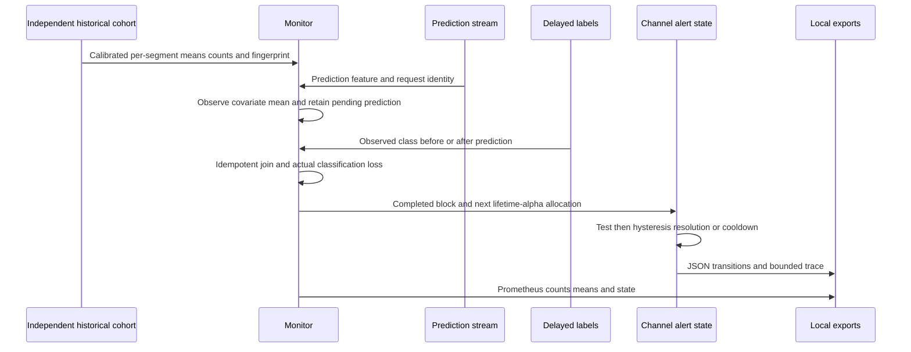

# From observation to alert state

`monitor.py` implements independent reference calibration, bounded input records, join identity, alpha spending, two-sample tests, alert state and exports. `experiments.py` uses separate calibration/event/delay random streams to measure stationary false openings and changed-stream delay. The CLI produces JSON and real Prometheus text; it never calls a monitoring service or a model.

Read [spending-and-delay.md](spending-and-delay.md) for exact assumptions and finite-epoch limitations, and [change-trajectories.md](change-trajectories.md) for executed denominators and delays.
